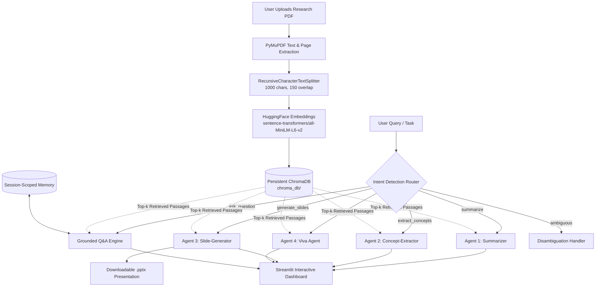

# ✈️ PaperPilot-AI

**PaperPilot-AI** is an AI-powered, agentic research paper assistant engineered for undergraduate and graduate students, educators, and early-stage researchers. It bridges the gap between dense academic literature and accessible student comprehension through automated text extraction, multi-perspective summaries, core concept extraction, presentation deck generation, oral viva preparation, and grounded conversational question answering.

The application features a dual-operational architecture: it functions **100% offline out-of-the-box** using local sentence-transformer embeddings, a ChromaDB vector database, and deterministic extractive NLP algorithms. When an optional Google Gemini API key is configured, it activates live generative AI pipelines via LangChain Expression Language (LCEL).

---

## 📑 Table of Contents
- [Problem Statement](#-problem-statement)
- [Project Objectives](#-project-objectives)
- [Core Features](#-core-features)
- [Architecture & Workflow](#-architecture--workflow)
- [The 4 Specialized AI Agents](#-the-4-specialized-ai-agents)
- [Intent Detection & Routing](#-intent-detection--routing)
- [Dual Operational Modes: Offline vs. Live LLM](#-dual-operational-modes-offline-vs-live-llm)
- [Acceptance Criteria Mapping](#-acceptance-criteria-mapping)
- [Technology Stack](#-technology-stack)
- [Repository Structure](#-repository-structure)
- [Getting Started](#-getting-started)
- [Running Test Suites](#-running-test-suites)
- [Presentation Export (.pptx)](#-presentation-export-pptx)
- [Limitations & Future Roadmap](#-limitations--future-roadmap)

---

## 🧩 Problem Statement

Contemporary computer science and AI research is published at an unprecedented velocity. Students attempting to comprehend academic papers frequently encounter:
1. **Cognitive Overload:** Dense mathematical notation, multi-column layouts, and domain jargon create steep comprehension barriers.
2. **Fragmented Insights:** Core research objectives, algorithmic pipelines, empirical benchmarks, and critical limitations are rarely synthesized in one place.
3. **Defense Anxiety:** University viva-voce examinations and thesis reviews demand multi-tiered conceptual mastery that standard reading does not provide.
4. **Hallucination Risks in LLMs:** Unconstrained chatbots frequently hallucinate nonexistent metrics or methods when asked about technical papers.

---

## 🎯 Project Objectives

- **High-Fidelity Document Ingestion:** Rapid extraction of clean text and per-page structures from research PDFs using **PyMuPDF**.
- **Offline-First Vector Storage:** Zero API-quota dependency for document indexing, utilizing **RecursiveCharacterTextSplitter**, local **HuggingFace Embeddings** (`sentence-transformers/all-MiniLM-L6-v2`), and a persistent **ChromaDB** store.
- **Agentic Multi-Role Synthesis:** Four distinct, specialized agents orchestrated via **LangChain Expression Language (LCEL)**.
- **Intent-Aware Routing:** Automatic detection and classification of user queries to route tasks to the designated agent or grounded Q&A engine.
- **Grounded Verification:** Strict grounding constraints ensuring all answers cite source page numbers and retrieved passages directly.

---

## 🌟 Core Features

1. **High-Speed PDF Parsing:** Instant extraction of text, character counts, and page dictionaries using PyMuPDF.
2. **ChromaDB Vector Retrieval:** Real-time document chunking (1000 characters, 150 overlap) with persistent storage and similarity-based retrieval with distance scores.
3. **Structured Research Summary (Agent 1):** Synthesizes multi-perspective summaries covering objectives, problem statements, methods, empirical findings, limitations, and conclusions.
4. **Concept & Math Extraction (Agent 2):** Dissects theoretical concepts, algorithmic steps, and quantitative metrics alongside an undergraduate (ELI5) explanation.
5. **Academic Presentation Generator (Agent 3):** Generates a structured 6-to-8 slide deck with concise bullet points, spoken scripts, and downloadable PowerPoint (`.pptx`) export.
6. **10-Tiered Viva Preparation (Agent 4):** Curates 10 oral exam questions spanning Basic, Intermediate, and Advanced tiers with ideal model answers and examiner focus tips.
7. **Interactive Grounded Q&A ("Ask Your Paper"):** Conversational Q&A with dynamic intent detection, citation rendering, and session-scoped conversation memory.
8. **Document & Session Isolation:** Strict memory partitioning prevents cross-paper data leakage between sessions and different uploads.

---

## 🏗️ Architecture & Workflow



---

## 🤖 The 4 Specialized AI Agents

Every agent is built with dedicated **ChatPromptTemplate** schemas and **LangChain Expression Language (LCEL)** pipelines, paired with a matching deterministic offline engine:

| Agent | Source File | LCEL Chain Pipeline | Key Responsibilities |
|---|---|---|---|
| **1. Summarizer Agent** | [core/agents/summarizer.py](core/agents/summarizer.py) | `ChatPromptTemplate \| llm \| StrOutputParser()` | Produces structured summaries: Objectives, Problem Formulation, Methodology, Findings, Limitations, and Conclusion. |
| **2. Concept-Extractor Agent** | [core/agents/concept_extractor.py](core/agents/concept_extractor.py) | `ChatPromptTemplate \| llm \| StrOutputParser()` | Dissects theoretical ideas, algorithmic architecture, quantitative metrics, and ELI5 explanations. |
| **3. Slide-Generator Agent** | [core/agents/slide_generator.py](core/agents/slide_generator.py) | `ChatPromptTemplate \| llm \| StrOutputParser()` | Generates 6–8 conference slides with bullet points, spoken scripts, and `.pptx` export. |
| **4. Viva Agent** | [core/agents/viva_agent.py](core/agents/viva_agent.py) | `ChatPromptTemplate \| llm \| StrOutputParser()` | Formulates 10 defense questions (Basic, Intermediate, Advanced) with model answers and tips. |

---

## 🧭 Intent Detection & Routing

The intent router ([core/router.py](core/router.py)) evaluates user requests dynamically:
- **Dual Classification Engine:** Employs an LLM classifier when an API key is available, backed by a deterministic regex-based keyword classifier for offline usage.
- **Ambiguity Detection:** Detects empty, multi-intent, or contradictory queries and offers structured clarifying options rather than selecting an agent at random.
- **Execution Payload:** Returns a standardized dictionary containing `status`, `intent`, `agent`, `output`, `sources` (with page numbers and distance scores), and `classifier_engine`.

---

## ⚡ Dual Operational Modes: Offline vs. Live LLM

PaperPilot-AI distinguishes between offline operations and live LLM generation:

1. **Offline Mode (Default — 100% Demonstrable without API Keys):**
   - **Embeddings:** Runs locally via `sentence-transformers/all-MiniLM-L6-v2` (384-dimensional).
   - **Vector Store:** ChromaDB persists collections to disk (`chroma_db/`) and executes similarity queries locally.
   - **Extractive Engine:** [core/offline_engine.py](core/offline_engine.py) performs sentence tokenization, stopword filtering, and TF-IDF centrality ranking.
   - **Labeling:** Outputs are clearly tagged with institutional amber badges (e.g. `Offline Extractive Summary — No Gemini API`) so non-LLM outputs are never misrepresented as generative AI. If a section is missing from the paper, it displays `"Not explicitly identified in the extracted text."` without fabrication.

2. **Live LLM Mode (Optional — Enabled via API Key):**
   - **Model:** Configurable via the `GEMINI_MODEL` environment variable (default: `gemini-3.8-flash`, alternative: `gemini-3.5-flash-lite`).
   - **Execution:** When `GOOGLE_API_KEY` is supplied in `.env` or via the sidebar, LangChain LCEL chains execute live synthesis against retrieved ChromaDB passages.
   - **Status Note:** Automated unit and integration tests verify LCEL chain assembly, prompt formatting, and error handling. Because no real API key is committed to this repository, live generation against Google's servers is formally designated as **UNTESTED** until a key is supplied.

---

## 📋 Acceptance Criteria Mapping

| # | Mandatory Assignment Criterion | Status | Implementation File | Verification & Evidence |
|---|---|---|---|---|
| **1** | **LLM Integration** | **IMPLEMENTED — LIVE API UNTESTED** | [core/config.py](core/config.py) | `get_llm()` initializes `ChatGoogleGenerativeAI(model=get_gemini_model_name())` (`gemini-3.8-flash` default, `gemini-3.5-flash-lite` alternative) safely using keys from `.env` or sidebar overrides. |
| **2** | **Interactive GUI** | **COMPLETE** | [app.py](app.py) | Streamlit dashboard in institutional white & light-blue (`#0284c7`, `#f8fafc`), with document metrics, uploader, 7 dedicated views, and citation expanders. |
| **3** | **Prompt Engineering** | **COMPLETE** | [core/agents/](core/agents/), [core/router.py](core/router.py) | Explicit system personas, grounding rules, strict negative constraints, output formatting schemas, and dynamic input slots (`filename`, `context`, `user_query`). |
| **4** | **LangChain Templates & LCEL** | **COMPLETE** | [core/agents/](core/agents/), [core/router.py](core/router.py) | Built entirely on `ChatPromptTemplate` and `prompt \| llm \| StrOutputParser()` pipe syntax. Verified via [test_agents.py](test_agents.py). |
| **5** | **Agentic RAG** | **COMPLETE** | [core/vectorstore.py](core/vectorstore.py), [core/router.py](core/router.py) | Evaluates when retrieval is required, querying top-k chunks from ChromaDB and supplying grounded context to LCEL chains and offline extractors. |
| **6** | **Intent Detection and Routing** | **COMPLETE** | [core/router.py](core/router.py) | Classifies queries into 5 intent categories (`summarize`, `extract_concepts`, `generate_slides`, `prepare_viva`, `ask_question`) + ambiguity handling. Verified via [test_router.py](test_router.py). |
| **7** | **ChromaDB Vector Database** | **COMPLETE** | [core/vectorstore.py](core/vectorstore.py) | Persistent storage in `chroma_db/`, document-scoped collections, `RecursiveCharacterTextSplitter`, and 384-dim HuggingFace embeddings. Verified via [test_rag.py](test_rag.py). |

---

## 🛠️ Technology Stack

- **Interactive Dashboard:** Streamlit 1.65.0
- **PDF Extraction:** PyMuPDF 1.28.2
- **Agentic Framework:** LangChain 1.4.10, LangChain Core 1.7.7, LangChain Community 0.4.2
- **LLM Integration:** LangChain Google GenAI 4.4.3 (`gemini-3.8-flash` default, configurable via `GEMINI_MODEL`, alternative: `gemini-3.5-flash-lite`)
- **Vector Database:** ChromaDB 1.5.9
- **Local Embeddings:** Sentence-Transformers 6.3.0 (`sentence-transformers/all-MiniLM-L6-v2`)
- **Presentation Export:** python-pptx 1.0.2
- **Configuration & Secrets:** python-dotenv 1.2.4

---

## 📁 Repository Structure

```text
PaperPilot-AI/
├── .env.example                  # Environment configuration template (safe for Git)
├── .gitignore                    # Excludes .env, .venv, chroma_db, and caches
├── requirements.txt              # Dependency requirements for Python 3.10.11
├── README.md                     # Comprehensive academic documentation
├── app.py                        # Streamlit web application & user interface
├── sample_research_paper.pdf     # Pre-generated sample PDF for immediate testing
├── create_sample_pdf.py          # Generator utility for sample research PDFs
│
├── core/                         # Core Agentic AI & RAG Backend
│   ├── __init__.py               # Core package initialization
│   ├── config.py                 # Secure environment loading & LLM instantiation
│   ├── vectorstore.py            # Text chunking, ChromaDB storage, & HuggingFace embeddings
│   ├── memory.py                 # Session- and document-isolated conversation memory
│   ├── offline_engine.py         # Deterministic extractive NLP fallback engine
│   ├── router.py                 # Intent classification & agent dispatching
│   ├── pptx_export.py            # PowerPoint (.pptx) generator with speaker notes
│   └── agents/                   # The 4 Specialized LCEL Agents
│       ├── __init__.py           # Agent package initialization
│       ├── summarizer.py         # Agent 1: Structured Academic Summary
│       ├── concept_extractor.py  # Agent 2: Concepts, Math, Benchmarks, & ELI5
│       ├── slide_generator.py    # Agent 3: 6-8 Presentation Slides Deck
│       └── viva_agent.py         # Agent 4: 10 Oral Defense Questions & Answers
│
├── test_rag.py                   # Automated test: RAG chunking, embeddings, & ChromaDB
├── test_agents.py                # Automated test: LCEL agent assembly & offline fallbacks
├── test_memory.py                # Automated test: Memory storage, trimming, & isolation
├── test_router.py                # Automated test: Intent classification & agent routing
├── test_integration.py           # Automated test: Full pipeline & PPTX generation
└── run_all_tests.py              # Master test runner executing all test suites
```

---

## 🚀 Getting Started

### 1. Prerequisites
- **Python**: Version `3.10.11` recommended.
- **Git**: Installed on your system.

### 2. Setup Virtual Environment & Install Dependencies
Open your terminal in the project directory:

```bash
# Create virtual environment (if not already present)
python -m venv .venv

# Activate virtual environment
# On Windows (PowerShell):
.\.venv\Scripts\Activate.ps1
# On Linux / macOS:
source .venv/bin/activate

# Install all requirements
pip install -r requirements.txt
```

### 3. Optional: Configure Gemini API Key
To enable live generative LLM features, create a `.env` file from `.env.example`:

```bash
cp .env.example .env
```

Edit `.env` to include your Google Gemini API key:
```env
GOOGLE_API_KEY=your_actual_gemini_api_key_here
GEMINI_MODEL=gemini-3.8-flash
```

*(If you do not have an API key, leave `.env` unconfigured; PaperPilot-AI will automatically run in Offline Extractive Mode with local ChromaDB vector retrieval).*

### 4. Launch the Dashboard
Start the Streamlit application:

```bash
streamlit run app.py
```
Open your browser and navigate to:
```text
http://localhost:8501
```

---

## 🧪 Running Test Suites

PaperPilot-AI includes a comprehensive, automated offline test suite. All tests run locally without making external API requests:

```bash
python run_all_tests.py
```

### Individual Test Descriptions:
- `python test_rag.py`: Verifies `RecursiveCharacterTextSplitter`, local 384-dimensional HuggingFace embeddings, and ChromaDB persistence in `chroma_db/`.
- `python test_agents.py`: Validates LCEL `RunnableSequence` assembly for all 4 agents and confirms that offline extractive fallbacks produce structured output when no API key is present.
- `python test_memory.py`: Tests turn logging, history trimming, document isolation, and multi-session separation.
- `python test_router.py`: Tests rule-based and LLM-based intent detection, ambiguous query handling, and grounded retrieval routing.
- `python test_integration.py`: Tests the full pipeline end-to-end, including PDF parsing, ChromaDB indexing, and binary `.pptx` presentation compilation.

---

## 🖥️ Presentation Export (.pptx)

The **Slide-Generator Agent** translates paper findings into structured presentation decks. When clicking **Download Presentation (.pptx)**:
- Compiles an academic 16:9 widescreen presentation using `python-pptx`.
- Applies institutional slide styling with dark-slate headers and light-blue accents.
- Formats presenter scripts into the native PowerPoint **Speaker Notes** section of each slide.

---

## ⚠️ Limitations & Future Roadmap

- **Scanned Image PDFs:** Current extraction relies on embedded text streams parsed via PyMuPDF; scanned documents containing only bitmap images require an external OCR pre-processing step.
- **Embedded Diagrams & Figures:** Charts and diagrams are interpreted through textual descriptions and captions; future work will incorporate multimodal vision processing.
- **Live LLM Verification:** Live generative responses depend on active Google AI Studio credentials and model quotas.
